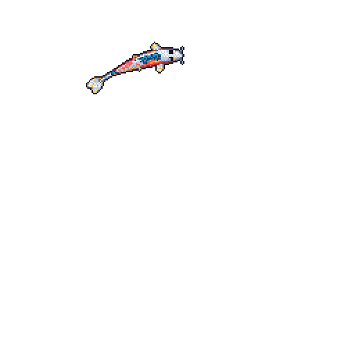

  <!-- Header Banner -->
  

  <!-- Animated Typing Subtitle -->
  

  

    
    
    
  

---

### 🌊 Daily Git Koi

  <table>
    <tr>
      <td align="center">
         
        <em>Live generative koi pond reflecting daily contribution ripples · updated every midnight UTC</em>
      </td>
    </tr>
  </table>

---

### 🚀 Featured Projects

<table width="100%">
  <tr>
    <td width="50%" valign="top">
      <h4><a href="https://github.com/teotiabhumik-ship-it/ClearClickAI">🔍 ClearClick AI</a></h4>
      
<strong>Evidence-based Dark Pattern Detection & Fair Design Advisor</strong>

      
Automated web audit engine analyzing DOM elements, computed styles, WCAG contrast compliance, and interaction flows to flag manipulative UX patterns with mathematical precision and zero hallucinations.

      

        
        
        
        
        
      

    </td>
    <td width="50%" valign="top">
      <h4><a href="https://github.com/teotiabhumik-ship-it/study-bus-b">🚌 Study Bus (Focus Transit)</a></h4>
      
<strong>3D Collaborative Transit Study & Deep-Work PWA</strong>

      
Atmospheric commuter bus experience with dynamic Three.js rain physics, strict zero-telemetry client data sovereignty, and WebCrypto ECDSA/ECDH E2E encrypted study rooms.

      

        
        
        
        
      

    </td>
  </tr>
  <tr>
    <td width="50%" valign="top">
      <h4><a href="https://github.com/teotiabhumik-ship-it/protypist-free">⚡ TypePulse</a></h4>
      
<strong>Modern Typing Engine & SSC CGL DEST (TCS iON) Simulator</strong>

      
Dual-purpose typing suite with real-time fluid caret tracking, theme transitions, error heatmaps, and authentic TCS iON exam simulation with Dynamic Programming LCS token alignment.

      

        
        
        
        
      

    </td>
    <td width="50%" valign="top">
      <h4><a href="https://github.com/teotiabhumik-ship-it/proofloop">⚖️ ProofLoop</a></h4>
      
<strong>Evidence-Backed Decision Workspace for AI Recommendations</strong>

      
Inspectable recommendation engine keeping questions, criteria weights, source conflicts, and assumptions visible with deterministic sensitivity analysis and offline regression suites.

      

        
        
        
        
      

    </td>
  </tr>
</table>

---

### 🛠️ Technical Arsenal

| Domain | Technologies |
| :--- | :--- |
| **Languages** | `Python` · `TypeScript` · `JavaScript (ES6+)` · `HTML5` · `CSS3` · `SQL` · `C/C++` |
| **Frontend & UI** | `React` · `Vite` · `Tailwind CSS` · `Three.js` · `Electron` · `Next.js` · `PWA` |
| **Backend & Architecture** | `FastAPI` · `Node.js` · `Express` · `RESTful APIs` · `WebSockets` · `Docker` |
| **AI, Verification & Testing** | `Evidence-Grounded LLM Pipelines` · `Playwright` · `Pytest` · `WCAG 2.1 AA` · `WebCrypto API` |
| **DevOps & Tooling** | `Git` · `GitHub Actions` · `Linux / Shell` · `Make` · `Docker Compose` |

---

### 📊 GitHub Activity & Metrics

  
  

  

---

### 🤝 Let's Connect

  Have an interesting idea, want to collaborate on open-source software, or talk systems engineering?

   

  
  

